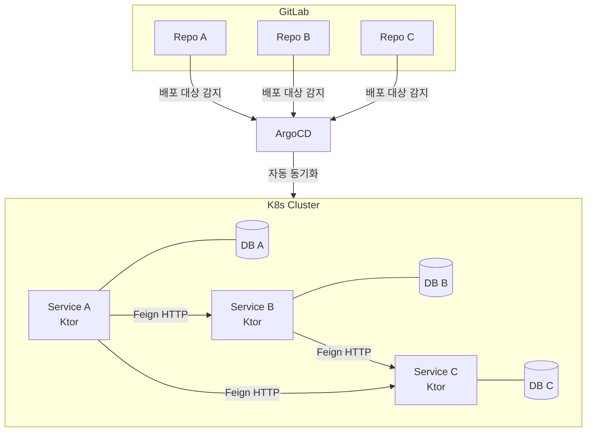

> 이전에 모놀리식 아키텍처를 MSA 구조로 전환하는 작업을 했던 적이 있습니다. 사실 전혀 확장할 필요가 없는 규모였지만 초기 스타트업에서 정부 R&D 과제를 수행해야 했고, 'MSA 아키텍처 전환'이 요구 조건 중 하나였기 때문에 수행했습니다. 당시엔 지식도 부족했고, 실제 어떤 서비스 단위로 트래픽이 몰리고 쓰이는지를 측정할 수 없으니 추측에 기반한 도메인 성격으로 서비스를 나눴는데, 이 경험을 계기로 **모듈러 모놀리식(Modular Monolith)**을 공부하면서 정리한 내용입니다.


---


## 겪었던 MSA 안티패턴: 조인이 http 호출로

당시 전환한 구조를 요약하면 이렇습니다. 기존 하나로 운영하던 서비스를 A/B/C로 각각 분리하고, 서비스 간 통신은 feign client http로 처리했습니다. 배포 파이프라인은 ArgoCD가 각 저장소 상태를 보고 Kubernetes 클러스터에 배포하는 전형적인 GitOps 구성이었습니다.



겉보기엔 MSA화가 잘 된 것처럼 보이는 구성이었습니다. 문제는 그 안의 **서비스 경계**였습니다. 원래 하나의 도메인처럼 붙어있던 A/B/C가 각자 DB를 들고 쪼개지면서, 서로의 데이터가 필요한 조회에 전부 HTTP 통신이 일어났습니다. 실제로는:

- **네트워크 지연**이 DB 조인 대신 매 요청마다 끼어듦
- 두 서비스가 **트랜잭션 경계를 공유하지 못해** 정합성을 직접 챙겨야 함
- 서비스 A가 서비스 B 없이는 아무것도 못 하는데, **배포/코드는 따로** 관리해야 하는 이중 부담
- 서비스 B에 장애가 나면 그대로 서비스 A까지 전파

이게 흔히 말하는 **분산 모놀리스(Distributed Monolith)**입니다. MSA의 장점(독립 배포, 독립 확장)은 하나도 못 누리면서, MSA의 단점(네트워크 오버헤드, 운영 복잡도, 분산 트랜잭션)만 그대로 떠안는 상태입니다.

---

## 대안: 모듈러 모놀리식

모듈러 모놀리식은 **물리적으로는 하나의 배포 단위(하나의 애플리케이션, 하나의 DB)를 유지하면서, 코드 상으로는 도메인별 경계를 엄격하게 나누는** 접근입니다.

핵심 아이디어는 이렇습니다.

- 모듈 간 통신은 **인프로세스 함수 호출**만 허용 (HTTP 같은 원격 호출 금지)
- 모듈은 **바운디드 컨텍스트** 단위로 나눔 (기술 레이어가 아니라 비즈니스 책임 기준)
- 모듈 내부 구현은 **캡슐화**해서, 다른 모듈이 함부로 들여다볼 수 없게 함
- 정말 독립 배포/확장이 필요해지는 시점이 오면, **그때 실제로 마이크로서비스로 추출**

즉 "MSA를 할지 말지"를 처음부터 결정하지 않고, **경계만 미리 깨끗하게 만들어두고 결정을 미루는 전략**입니다.

### 레이어 구조 vs 바운디드 컨텍스트 구조

흔히 쓰는 layered 구조는 **기술적 역할**이 최상위 기준입니다. `Order`라는 도메인 하나가 어떻게 흩어지는지 보면 이렇습니다.

```
com.example
 ├── controller/
 │    ├── OrderController.kt
 │    └── InventoryController.kt
 ├── service/
 │    ├── OrderService.kt
 │    └── InventoryService.kt
 ├── repository/
 │    ├── OrderRepository.kt
 │    └── InventoryRepository.kt
 └── entity/
      ├── Order.kt
      └── Inventory.kt
```

`Order` 하나를 이해하려면 4개 폴더를 다 열어봐야 하고, 그 옆엔 `Inventory` 관련 파일이 나란히 놓여 있습니다. `OrderService`가 `InventoryRepository`를 바로 참조해도 컴파일도 되고 테스트도 통과합니다 — **같은 레이어에 있다는 이유만으로 도메인 간 경계가 사실상 없는 것**입니다.

모듈러 모놀리식은 **비즈니스 책임**을 최상위 기준으로 삼습니다.

```
com.example
 ├── order/
 │    ├── api/
 │    │    └── OrderPort.kt
 │    ├── domain/
 │    │    └── Order.kt
 │    ├── infrastructure/
 │    │    └── OrderRepository.kt
 │    └── internal/
 │         └── OrderService.kt
 └── inventory/
      ├── api/
      │    └── InventoryPort.kt
      ├── domain/
      │    └── Inventory.kt
      ├── infrastructure/
      │    └── InventoryRepository.kt
      └── internal/
           └── InventoryService.kt
```

이제 `order`와 `inventory`는 완전히 다른 폴더 트리입니다. `order.internal.OrderService`가 `inventory.infrastructure.InventoryRepository`를 참조하는 건 여전히 물리적으로는 가능하지만(같은 모놀리식 안이니까), 이걸 못 하게 **강제**하는 게 다음 섹션에서 다룰 ArchUnit/Spring Modulith입니다.

- `api` — 다른 모듈에 공개하는 계약(인터페이스 + DTO)
- `internal` — 실제 구현체, 외부 모듈 접근 금지
- `domain` / `infrastructure` — 순수 로직 / 외부 연동 어댑터

---

## 경계를 테스트로 강제하기

구조를 이렇게 나눠도, 실제로 다른 모듈의 `internal` 클래스를 import해버리면 컴파일은 됩니다. 사람이 코드리뷰로 매번 잡아내는 건 지속가능하지 않아서, 이 경계를 자동으로 검증해주는 도구가 필요합니다.

### ArchUnit

경계 규칙을 직접 짤 수 있는 라이브러리입니다. "internal 패키지는 같은 모듈 밖에서 접근하면 안 된다" 같은 규칙을 테스트로 표현하고, 위반하면 테스트가 실패합니다.

### Spring Modulith

Spring 진영이 이 패턴 자체를 공식화한 프로젝트입니다. ArchUnit을 내부적으로 사용하지만, 컨벤션 기반으로 훨씬 적은 코드로 같은 구현을 할 수 있습니다.

- 메인 애플리케이션 클래스 바로 아래의 **서브패키지**가 자동으로 **모듈**로 인식됨
- `ApplicationModules.of(Application::class.java).verify()` 한 줄로 전체 모듈 경계를 검증

```kotlin
class ModularityTests {
    @Test
    fun verifiesModularStructure() {
        ApplicationModules.of(Application::class.java).verify()
    }
}
```

**Kotlin에서 주의할 점**: Java의 `package-info.java`가 Kotlin엔 없어서, 모듈 루트에 `@PackageInfo`가 붙은 마커 클래스를 대신 둬야 합니다.

```kotlin
package com.example.order

@ApplicationModule
@PackageInfo
class ModuleMetadata
```

**@NamedInterface**: Spring Modulith 기본 규칙은 "모듈 **루트**에 있는 것만 공개, `api`를 포함한 모든 서브패키지는 기본 비공개"입니다. `api`처럼 공개가 필요한 서브 패키지는 `@PackageInfo` 마커 클래스를 두는 것과 동일하게 `@NamedInterface`를 명시적으로 붙여야 다른 모듈에서 접근 가능합니다.

```kotlin
package com.example.order.api

@NamedInterface("api")
@PackageInfo
class PackageMarker
```

### 규칙이 진짜 동작하는지 확인

세 가지 케이스로 규칙이 동작하는지 확인했습니다. 구조는 아래와 같습니다.
```
com.example
 ├── routing/
 │    ├── api/
 │    │    ├── RoutingPort.kt
 │    │    └── PackageMarker.kt // @NamedInterface를 위한 마커클래스
 │    └── internal/
 │         └── RoutingService.kt
 └── provider/
      └── api/
           └── VerifyMarker.kt
```


**1.** 다른 모듈에서 `internal` 클래스를 실제로 참조 → `verify()` **실패** (의도대로 차단)

  ```kotlin
  package com.example.provider.api
  
  import com.example.routing.internal.RoutingService

  class VerifyMarker(
    val routingService: RoutingService 
  )
  ```
  {: file='provider/api/VerifyMarker.kt' }

  ![9-2][9-2]

**2.** `@NamedInterface`가 붙은 `api` 클래스를 참조 → `verify()` **통과**

  ```kotlin
  package com.example.routing.api
  
  import org.springframework.modulith.NamedInterface
  import org.springframework.modulith.PackageInfo

  @NamedInterface("api")
  @PackageInfo
  class PackageMarker
  ```
  {: file='routing/api/PackageMarker.kt' }

  ```kotlin
  package com.example.provider.api
  
  import com.example.routing.api.RoutingPort

  class VerifyMarker(
    val routingPort: RoutingPort
  )
  ```
  {: file='provider/api/VerifyMarker.kt' }

  ![9-3][9-3]

**3.** `@NamedInterface` 없이 `api` 클래스를 참조 → `verify()` **실패** (서브패키지는 기본 비공개)

  ![9-4][9-4]


> **`import`만 하고 실제로 타입을 사용하지 않으면 통과합니다.** 안 쓰는 import는 컴파일러가 바이트코드에서 지워버려서 감지하지 않습니다.
{: .prompt-info}

---

## 모듈 경계가 틀렸을 경우

실제 운영 데이터 없이 도메인 경계를 완벽하게 예측하는 건 불가능합니다. 모듈러 모놀리식의 유리한 점은 "처음에 맞게 나눌 수 있다"가 아니라, **"잘못 나눴다는 걸 알았을 때 고치는 비용이 적다"**입니다.

MSA에서 서비스 경계를 잘못 그었다면, 코드 저장소를 옮기고 DB 데이터를 마이그레이션하고 CI/CD 파이프라인을 다시 엮고 이미 그 서비스를 쓰는 다른 팀과 API 계약까지 조율해야 합니다. 나중에 경계가 틀린 걸 알아도 고치는 비용이 너무 커서 그대로 두는 경우도 많습니다. 

반면 모듈러 모놀리식에서 패키지 경계를 잘못 나눴다면, 파일을 다른 패키지로 옮기고 import 경로만 바꾸면 됩니다. DB는 원래 하나라 마이그레이션이 필요 없고, 배포 파이프라인도 하나라 조율할 대상이 없습니다. `verify()` 테스트가 있으니 옮기는 도중 경계가 깨졌는지도 바로 피드백을 받습니다. 

물리적 분리(서비스, DB, 배포)처럼 되돌리기 어려운 결정은 실제 운영 데이터가 쌓일 때까지 미루고, 논리적 분리(패키지 경계)처럼 되돌리기 쉬운 결정만 먼저 해두는 것이 모듈러 모놀리식의 핵심 전략입니다.

---

## 나중에 진짜 MSA가 필요해지면

모듈러 모놀리식으로 아키텍처를 설계해두면, 나중에 정말 서비스를 분리해야 할 근거가 생겼을 때 이미 경계가 깨끗해 전환 비용이 적게 듭니다.

- 모듈 간 계약이 `api` 인터페이스로 이미 분리되어 있으면, 구현체만 "로컬 호출"에서 "원격 호출(HTTP/gRPC)"로 바꿔치기하면 됨
- Spring Modulith는 모듈 간 통신을 애초에 **이벤트 기반**으로 설계하도록 유도하는데(`@ApplicationModuleListener`), 이렇게 만들어두면 `@Externalized` 어노테이션 하나로 실제 메시지 브로커(Kafka 등) 발행으로 쉽게 전환이 가능합니다.

다만 여기엔 중요한 단서가 붙습니다. **DB 분리는 모듈러 모놀리식으로 시작해도 여전히 필요하고, 실제 MSA 전환에서 제일 어려운 부분으로 남습니다.** `ApplicationModules.verify()`는 Kotlin/Java 코드의 import만 검사할 뿐, SQL 레벨에서 어떤 모듈이 어떤 테이블을 건드리는지는 전혀 보지 않습니다. `provider` 모듈이 `routing` 소유 테이블을 네이티브 쿼리로 직접 조회해도 Modulith는 잡아내지 못합니다.

그래서 모듈러 모놀리식이 DB 분리를 쉽게 만들어주는 게 아니라, 정확히는 다음 조건을 지켰을 때만 **"덜 위험하게"** 만들어줍니다 — 각 모듈의 `infrastructure`만 자기 테이블에 접근하고, 다른 모듈 테이블은 절대 직접 조회하지 않는 규율을 코드 경계뿐 아니라 **데이터 접근 수준까지** 지키는 것. 이러면 물리적으로는 하나의 DB에 있어도 테이블 소유권은 이미 논리적으로 나뉜 상태라, 분리 시점엔 "얽힌 걸 풀어헤치는 작업"이 아니라 "이미 주인이 분명한 테이블을 옮기는 작업"이 됩니다. 반대로 코드 경계만 지키고 DB 레벨에서는 여전히 다른 모듈 테이블에 조인·직접 쿼리를 허용했다면, 이 이점은 사라지고 DB 분리는 처음부터 다시 시작하는 것과 다르지 않습니다.


---


## 마무리

MSA는 "정답"이 아니라 **특정 문제(독립 배포, 독립 확장, 팀 자율성)를 풀기 위한 도구**입니다. 서비스를 어떤 단위로 쪼갤지는 실제 서비스를 운영하며 오랜 데이터가 축적되기 전까지는 결정하기 어렵습니다. 문제가 없는 상태에서 먼저 쪼개면, 복잡도만 떠안고 아무 이득도 못 얻습니다. 모듈러 모놀리식은 "일단 하나로 유지하되, 언제든 분리할 수 있게 설계하고 틀리더라도 고칠 수 있는 상태를 유지한다"는 태도로 그 사이의 간극을 메워주는 좋은 접근이라고 생각합니다.

[9-1]: posts/9-1.png
[9-2]: posts/9-2.png
[9-3]: posts/9-3.png
[9-4]: posts/9-4.png
